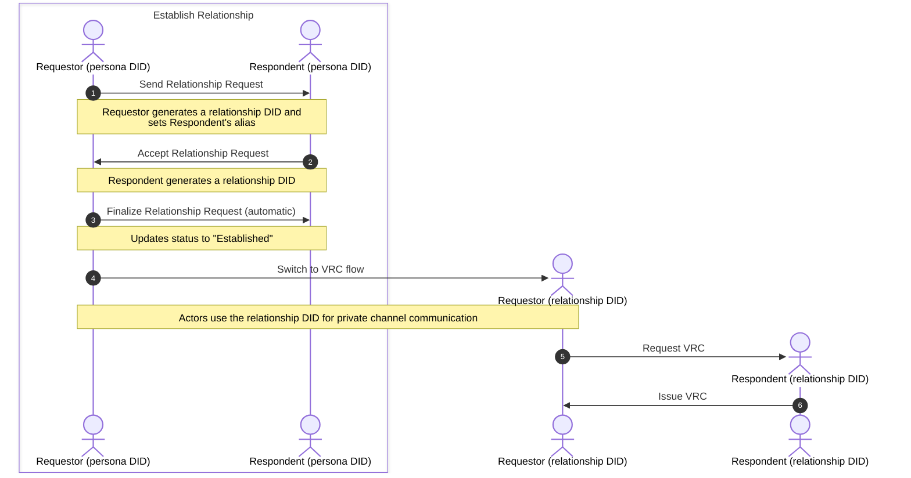

# Relationships and VRCs

OpenVTC lets you establish relationships with other DIDs (peers, co-workers, community members) and communicate privately over DIDComm. You do this in the TUI: run `openvtc` and use the **My Relationships**, **Inbox** and **My Credentials** panels from the main menu. There are no command-line subcommands for relationships or VRCs.

Each relationship gets its own **relationship DID** by default — a pairwise identifier used only with that one contact. You can choose to use your **persona DID** instead; see [Choosing your identifier](#choosing-your-identifier) for what that costs.

DTG Credentials no longer types an identifier by the role it plays (the retired
"R-DID" and "P-DID" labels named a role and a correlation width in one token).
What an identifier carries instead is a declared **correlation scope** —
`pairwise`, `directed` or `public` — stated in the `issuerScope` of every
credential issued under it. See [The scope a VRC declares](#the-scope-a-vrc-declares).

Once a relationship is established, you can request a **Verifiable Relationship Credential (VRC)**: a peer-to-peer credential that attests to a trust relationship between two parties.

_The diagram below illustrates the typical flow of establishing a relationship and requesting a VRC. A relationship DID is generated to enable private channel communication between parties._



## Table of Contents

- [Choosing your identifier](#choosing-your-identifier)
  - [The scope a VRC declares](#the-scope-a-vrc-declares)
- [Establish a relationship](#establish-a-relationship)
- [Request and issue a VRC](#request-and-issue-a-vrc)
- [View your VRCs](#view-your-vrcs)
- [Have a relationship witnessed](#have-a-relationship-witnessed)

## Choosing your identifier

Every relationship is established under one of two identifiers, chosen when you
send the request or accept an incoming one. The default is the pairwise
relationship DID — unless the community you are working in declares
`relationshipIdentifierDefault: attributed`, in which case the form starts on
the persona DID. Either way the choice stays yours per relationship.

| | **Pairwise relationship DID** (default) | **Your persona DID** |
| --- | --- | --- |
| What the contact sees | A fresh `did:peer` used only with them | Your published `did:webvh` |
| Linkable to your other relationships | No — each contact sees a different identifier | Yes — every contact sees the same string |
| Resolvable by anyone | No | Yes, and it often carries your verified agent name |
| Recognisable as you | No, unless you tell them | Yes, immediately |

The cost of reusing the persona DID is that correlation stops being an inference
and becomes a lookup: two contacts who compare notes see the same identifier and
can resolve it to a named identity. That is why pairwise is the default.

The reason to choose the persona DID anyway is recognition — a contact who
already knows your published DID or agent name can verify it is really you
without a separate introduction.

Once a relationship holds a relationship DID, subsequent messages always use it.
There is no fallback to the persona DID mid-relationship.

**Note:** The three handshake messages (request, accept, finalise) are routed
between persona DIDs regardless of this choice, because the mediator has to
route them before a pairwise channel exists. The relationship DID takes over once
the relationship is established, and the VRC is issued under it — so the durable
credential, which is the artifact that would otherwise correlate you across
every relationship you hold, names only the pairwise identifier.

The handshake DIDs are observed once, by the mediator, at establishment. The
credential lasts as long as either party keeps it. That asymmetry is why the
issuer field mattered more than the routing does.

### The scope a VRC declares

Every VRC OpenVTC issues declares, in `issuerScope`, the correlation scope of
**its own issuer's** identifier — the identifier this relationship uses on your
side. It is derived from that identifier, not from a setting, so it cannot
disagree with what the relationship actually does:

| Your identifier in the relationship | Seeded by the community's `relationshipIdentifierDefault` | `issuerScope` |
| --- | --- | --- |
| A relationship DID minted for this one contact | `pairwise` (or undeclared) | `pairwise` |
| Your persona DID | `attributed` | `directed` |

A persona DID is never `pairwise`: every contact who relates to the persona sees
the same identifier, which is the legible graph an `attributed` community asks
for, and DTG Credentials names that `directed` — known to a set of
counterparties you chose. The declaration is about the issuer only; your
contact's VRC back to you declares their own scope.

The code is `openvtc_core::dtg::relationship_issuer_scope`.

## Establish a relationship

### 1. Send the request (requestor)

Open **My Relationships** from the main menu and press **`n`** for a new
request. Fill in the form:

| Field | Description |
| --- | --- |
| DID | The respondent's persona DID, or an agent name such as `example.com/@bob` |
| Alias | A local name for this relationship |
| Reason | Why you are asking |
| Contact you as | `Pairwise R-DID` (the default) or `Your persona DID` |

**Tab** (or **↑**/**↓**) moves between fields. On the last field, **Space**
changes the identifier and **Enter** sends the request. **Esc** cancels.

The last field is the choice described in
[Choosing your identifier](#choosing-your-identifier). The form explains the
trade-off for whichever option is selected.

Sending the request adds the respondent to your contacts. The relationship
appears in the list as **`[Request Sent]`**.

### 2. Accept the request (respondent)

Incoming messages arrive in the **Inbox** while OpenVTC is connected to your
mediator. A relationship request shows up as a task. Select it with **↑**/**↓**
and press **Enter** to open it, then:

- **`a`** — accept with a pairwise relationship DID (the default, private path)
- **`p`** — accept as your persona DID
- **`r`** — reject
- **`d`** — dismiss the task
- **Esc** — back to the list

The detail view states both outcomes at the point of choice. The requestor is
added to your contacts under the name they sent. To change it, open the
relationship in **My Relationships** and press **`e`**.

### 3. Finalisation (automatic)

Nothing more is needed from either side. When the requestor's OpenVTC receives
the acceptance, it marks the relationship **`Established`** and sends a
finalise message. When the respondent's OpenVTC receives that, it marks its side
**`Established`** too.

Once both sides show **`[Established]`** in **My Relationships**, you can
request VRCs.

### Managing a relationship

In **My Relationships**, select a relationship and press **Enter** to see its
detail: alias, agent name (if verified), both DIDs, state, and the VRCs issued
and received. From the detail view:

| Key | Action |
| --- | --- |
| `e` | Edit the alias |
| `p` | Ping the other party |
| `v` | Request a VRC from this relationship |
| `w` | Have the relationship witnessed (see below) |
| `d` | Remove the relationship (asks you to confirm with `y`) |
| ↑/↓ | Browse the relationship's VRCs |
| Esc | Back to the list |

A relationship whose relationship-DID keys were lost is marked
**⚠ needs re-establishment**. It can no longer send or receive; remove it and
establish it again.

## Request and issue a VRC

A VRC is a peer-to-peer credential attesting to a trust relationship between
two parties. It names each side by the identifier that side uses in *this*
relationship — the pairwise relationship DID by default, or the persona DID if
that was chosen when the relationship was established — and declares that
identifier's `issuerScope`
([The scope a VRC declares](#the-scope-a-vrc-declares)).

You can only request a VRC over an established relationship.

### 1. Request a VRC (requestor)

Either:

- in **My Relationships**, open the relationship and press **`v`**; or
- in **My Credentials**, press **`n`**, choose an established relationship with
  **↑**/**↓**, optionally type a reason, and press **Enter**. **Esc** cancels.

The request appears in your Inbox as an outbound VRC request.

### 2. Issue the VRC (respondent)

The request arrives in the **Inbox** as an inbound VRC request. Open it and
press **`a`** to issue the VRC, or **`r`** to reject it.

OpenVTC signs the VRC as the identifier your side uses in the relationship and
sends it. It is valid from the moment it is issued and has no expiry date. A
copy is kept in your **Issued** credentials.

A VRC has the DTG Credentials v1 shape: the v1 context second, a declared
`issuerScope`, and exactly one concrete type:

```json
{
  "@context": [
    "https://www.w3.org/ns/credentials/v2",
    "https://registry.trustoverip.org/dtg/context/v1"
  ],
  "id": "urn:uuid:6f1c2b0e-9a4d-4c8e-b7a1-2d5e8f3c9b10",
  "type": [
    "VerifiableCredential",
    "DTGCredential",
    "RelationshipCredential"
  ],
  "issuer": "did:peer:2.Vz6Mkgt...",
  "issuerScope": "pairwise",
  "validFrom": "2025-12-02T08:58:43Z",
  "credentialSubject": {
    "id": "did:peer:2.Vz6Mksm..."
  },
  "proof": {
    "type": "DataIntegrityProof",
    "cryptosuite": "eddsa-jcs-2022",
    "created": "2025-12-02T08:58:43Z",
    "verificationMethod": "did:peer:2.Vz6Mkgt...#key-1",
    "proofPurpose": "assertionMethod",
    "proofValue": "zAXERK8RVBH..."
  }
}
```

For more details, see the [DTG Credentials specification](https://github.com/trustoverip/dtgwg-cred-spec) (§VRC and *Correlation Scope*).

### 3. Store the VRC (requestor)

The issued VRC arrives in the **Inbox** as a **VRC Issued** task. OpenVTC only
accepts it from an established relationship. Open the task, review the
credential, and press **`a`** to store it.

## View your VRCs

Open **My Credentials** from the main menu. **Tab** switches between the
**Received**, **Issued**, **Membership** and **Vetting** tabs. Select a
credential with **↑**/**↓** and press **Enter** to see its details and raw JSON.
In the detail view:

- **`c`** — copy the credential JSON to the clipboard
- **`d`** — remove the credential (Received and Issued only; asks you to confirm
  with `y`)
- **Esc** — back to the list

The VRCs of a single relationship are also listed in its detail view in
**My Relationships**.

**VRCs stored by an older build.** A VRC stored before OpenVTC moved to DTG
Credentials v1 carries the retired pre-v1 context and no `issuerScope`, and no
current verifier accepts it. On load such a VRC is dropped with a logged reason
rather than kept or allowed to fail the config, and the My Credentials panel
says how many were set aside. Request a fresh VRC from those relationships.

## Have a relationship witnessed

A **witness** is an independent party that watches you present the VRC you issued
to a contact and then issues a **Verifiable Witness Credential (VWC)** saying so. A
community that trusts that witness can count the VWC — for example as evidence in a
personhood assertion.

Your VTA does the witnessing for you: it builds and signs every document as your
relationship DID, presents your credentials, and verifies and stores the witness's
credential. OpenVTC only carries the documents to the witness, on the relationship
DID's own connection, and hands its answers back to the VTA. Nothing is signed on
this device. See VTI's
[the VTA as a witnessed party](https://github.com/OpenVTC/verifiable-trust-infrastructure/blob/main/docs/02-vta/witness-party.md).

**In the TUI:** open the relationship in **My Relationships**, press **`w`**,
type the witness's DID or agent name, and press **Enter**. To also present your
community membership, press **Tab** before **Enter** (see below); it is off every
time the prompt opens. The status line follows each step. When it completes, the relationship's detail lists the witnessing — the
witness and the VWC's handle in your VTA's credential vault.

**What you need:**

- An account whose keys are held by a VTA. A BIP32 account keeps its keys on the
  device, so the VTA cannot sign as its relationship DIDs; witnessing is not
  available there.
- A VTA that serves `vta/witness/*` at 0.2 (VTI `vta-service` 0.62 or later — an
  older VTA answers `unsupportedVersion`), and an account credential that may request
  witnessing (`admin` or `initiator` in its context).
- An established relationship to which **you have issued a VRC** (you issue one by
  accepting the contact's VRC request). The witness observes you presenting your
  own half of the edge.
- Only if the witness asks for membership evidence: a live membership of a community
  it serves, which you choose to present (below).

**What the witness learns:** by default, only your relationship credential, in full —
your relationship DID and the contact's. Nothing about who you are.

**Presenting your membership is your choice, for one witnessing at a time.** Press
**Tab** on the prompt to turn it on; the prompt then says plainly that the witness
will learn **which community member is behind this relationship**. Your VTA then
presents your membership credential in full (the community, and the persona DID it
names) and, because that credential names your persona rather than the pairwise
relationship DID, links the two for the witness with a second presentation by your
persona (the *member link*, the submission's `memberPresentation`). Turn it on only
for a witness whose policy asks for membership evidence: a witness that asks for none
would learn who you are for nothing. The choice is never remembered — the next
witnessing starts with it off. Left off, OpenVTC names no membership to your VTA, and
no membership credential or member presentation is sent.

**When it does not complete,** the status line says why:

| Message | What to do |
| --- | --- |
| *the witness will not witness this relationship* | The witness's policy refused (`witness/session:refused`). Another witness may accept. |
| *the witness no longer holds this session* | The session expired or was used (`challengeMismatch`). Start again. |
| *the witness did not accept your credentials* | A proof, validity period, or a community it does not serve (`presentationInvalid`). |
| *your VTA holds no key of this relationship's DID* | The relationship predates VTA-held keys, or belongs to another context. Re-establish it. |
| *the witness did not answer* | It is offline or unreachable from your mediator. Try later or choose another witness. |

**Relationship credentials in the vault.** The VTA names what it presents by its
handle in its credential vault, so OpenVTC stores every VRC you issue there when it
connects to the VTA (and again, if needed, when a witnessing starts). Only a VRC
the vault does not already hold is stored, so a witnessing in progress is never
disturbed.

**A witnessing is never lost.** The VTA keeps every VWC it stored with its
evidence, and OpenVTC records each completed witnessing in your account's synced
state as soon as the VTA has stored it. If OpenVTC stopped before it could keep
the record, it rebuilds it at the next start from the VTA's own list
(`vta/witness/list`), for any relationship you still hold. A rebuilt witnessing
only reappears in the relationship's detail and among the choices of a personhood
assertion — it is never presented on its own.

**Personhood.** A personhood assertion presents **no** witness credential unless you
choose it. When the persona has witnessed relationships, pressing **`P`** in the
**Communities** panel (while a personhood challenge is live) first lists
them — the other party, the witness, the date and the credential's digest — with
none chosen, and says what the community learns from each one you include: that the
relationship exists (both relationship DIDs), which witness attested it, and its
digest. **Space** includes or excludes one; **Enter** asserts with exactly those (or
none). **`A`** asks to include all of them, for that one assertion only, and only
**`y`** to that question does; it is never remembered. Each included VWC is
presented with its session's **outcome evidence** — the session document and the
witness's answer — in the assertion's `outcomeEvidence`
(`vtc/members/personhood/assert/0.2`);
a community counts a VWC only with that evidence, only from a witness it lists as
trusted, and accepts at most 16 in one assertion.
