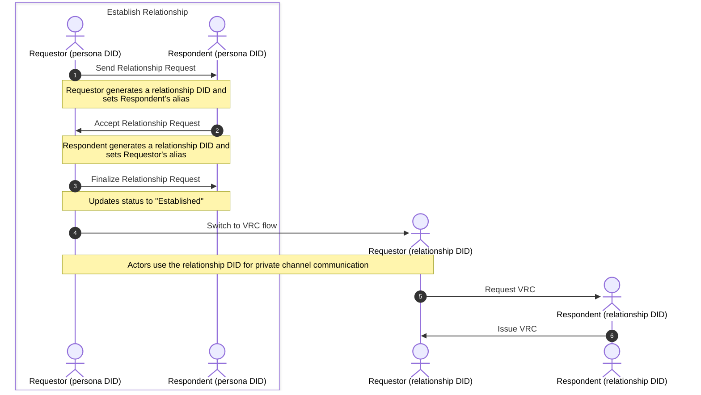

# Relationships and VRCs

> **Note:** The command examples in this guide predate the TUI and are being
> rewritten. The `openvtc relationships` and `openvtc vrcs` subcommands no
> longer exist — relationships are managed from the Relationships panel and the
> Inbox in the TUI. The flow and the concepts below are still accurate; only the
> invocations are stale.

The OpenVTC tool enables you to establish relationships with other DIDs (e.g., peers, coworkers, or community members) and communicate privately through the DIDComm protocol.

Each relationship gets its own **relationship DID** by default — a pairwise identifier used only with that one contact. You can choose to use your **persona DID** instead; see [Choosing your identifier](#choosing-your-identifier) for what that costs.

DTG Credentials no longer types an identifier by the role it plays (the retired
"R-DID" and "P-DID" labels named a role and a correlation width in one token).
What an identifier carries instead is a declared **correlation scope** —
`pairwise`, `directed` or `public` — stated in the `issuerScope` of every
credential issued under it. See [The scope a VRC declares](#the-scope-a-vrc-declares).

Once a relationship is established, you can request a **Verifiable Relationship Credential (VRC)**, a peer-to-peer credential that attests to verifiable trust relationships between personhood credential holders.

_The diagram below illustrates the typical flow of establishing a relationship and requesting a VRC. A relationship DID is generated to enable private channel communication between parties._



## Table of Contents

- [Choosing your identifier](#choosing-your-identifier)
  - [The scope a VRC declares](#the-scope-a-vrc-declares)
- [Establish Relationship](#establish-relationship)
  - [1. Send Relationship Request (Requestor)](#1-send-relationship-request-requestor)
  - [2. Accept Relationship Request (Respondent)](#2-accept-relationship-request-respondent)
  - [3. Finalise Relationship Request](#3-finalise-relationship-request)
- [Request Verifiable Relationship Credential (VRC)](#request-verifiable-relationship-credential-vrc)
  - [Prerequisite](#prerequisite)
  - [1. Request VRC Issuance (Requestor)](#1-request-vrc-issuance-requestor)
  - [2. Generate and Issue VRC (Respondent)](#2-generate-and-issue-vrc-respondent)
  - [3. Claim and Store VRC (Requestor)](#3-claim-and-store-vrc-requestor)
- [List and View VRCs](#list-and-view-vrcs)
- [Have a relationship witnessed](#have-a-relationship-witnessed)

## Choosing your identifier

Every relationship is established under one of two identifiers, chosen when you
send the request or accept an incoming one. The default is the pairwise
relationship DID — unless the community you are working in declares
`relationshipIdentifierDefault: attributed`, in which case the form starts on
the persona DID. Either way the choice stays yours per relationship.

| | **Pairwise relationship DID** (default) | **Your persona DID** |
| --- | --- | --- |
| What the contact sees | A fresh `did:peer` used only with them | Your published `did:webvh` |
| Linkable to your other relationships | No — each contact sees a different identifier | Yes — every contact sees the same string |
| Resolvable by anyone | No | Yes, and it often carries your verified agent name |
| Recognisable as you | No, unless you tell them | Yes, immediately |

The cost of reusing the persona DID is that correlation stops being an inference
and becomes a lookup: two contacts who compare notes see the same identifier and
can resolve it to a named identity. That is why pairwise is the default.

The reason to choose the persona DID anyway is recognition — a contact who
already knows your published DID or agent name can verify it is really you
without a separate introduction.

Once a relationship holds a relationship DID, subsequent messages always use it.
There is no fallback to the persona DID mid-relationship.

**Note:** The three handshake messages (request, accept, finalise) are routed
between persona DIDs regardless of this choice, because the mediator has to
route them before a pairwise channel exists. The relationship DID takes over once
the relationship is established, and the VRC is issued under it — so the durable
credential, which is the artifact that would otherwise correlate you across
every relationship you hold, names only the pairwise identifier.

The handshake DIDs are observed once, by the mediator, at establishment. The
credential lasts as long as either party keeps it. That asymmetry is why the
issuer field mattered more than the routing does.

### The scope a VRC declares

Every VRC OpenVTC issues declares, in `issuerScope`, the correlation scope of
**its own issuer's** identifier — the identifier this relationship uses on your
side. It is derived from that identifier, not from a setting, so it cannot
disagree with what the relationship actually does:

| Your identifier in the relationship | Seeded by the community's `relationshipIdentifierDefault` | `issuerScope` |
| --- | --- | --- |
| A relationship DID minted for this one contact | `pairwise` (or undeclared) | `pairwise` |
| Your persona DID | `attributed` | `directed` |

A persona DID is never `pairwise`: every contact who relates to the persona sees
the same identifier, which is the legible graph an `attributed` community asks
for, and DTG Credentials names that `directed` — known to a set of
counterparties you chose. The declaration is about the issuer only; your
contact's VRC back to you declares their own scope.

The code is `openvtc_core::dtg::relationship_issuer_scope`.

## Establish Relationship

Follow these steps to establish a relationship with another Persona DID.

### 1. Send Relationship Request (Requestor)

In the Relationships panel, start a new request and fill in:

| Field | Description |
| --- | --- |
| DID | The respondent's persona DID, or an agent name such as `example.com/@bob` |
| Alias | A local name for this relationship |
| Reason | Why you are asking |
| Contact you as | `Pairwise relationship DID` (default) or `Your persona DID` — press Space to change |

The last field is the choice described in [Choosing your identifier](#choosing-your-identifier).
It defaults to minting a fresh relationship DID for this contact.

**Note:** Initiating a relationship request automatically adds the respondent to your Contacts list.

Refer to the sample response below:

```bash
Generated new Relationship DID for contact FrancisP2 :: did:peer:2.Vz6Mkkop...

✅ Successfully sent Relationship Request to did:webvh:QmQzm...
```

For more details, see the [CLI documentation](./openvtc-tool-commands.md#openvtc-relationships).

### 2. Accept Relationship Request (Respondent)

1. Fetch and process incoming requests:

   ```bash
   openvtc tasks interact
   ```

   The tool fetches messages from the mediator. If you have a relationship request, you'll see a task with type **`Relationship Request`**.

   Open the task to see the request detail.

2. Accept it with either identifier:

   - `a` — accept with a pairwise relationship DID (the default, private path)
   - `p` — accept as your persona DID

   See [Choosing your identifier](#choosing-your-identifier) for the trade-off.
   The detail view states both outcomes at the point of choice.

3. Enter an alias for the requestor to easily identify this relationship.

After entering the alias, the tool updates the relationship status to **`Request Accepted`** and notifies the requestor.

Refer to the sample response below:

```bash
✅ Successfully sent Relationship Request Acceptance to did:webvh:Qmbea...
```

### 3. Finalise Relationship Request

Both parties must complete finalisation:

#### 1. Requestor

Run `openvtc tasks interact` to fetch the acceptance message. This updates the relationship status from **`Request Sent`** to **`Established`** and sends a finalisation message to the respondent.

Refer to the sample response below:

```bash
✅ Successfully sent Relationship Request Finalize to did:webvh:QmQzm...
Task Id: 020bb98e-5460-4d42-b369-bf4a65b4909c Type: Relationship request accepted
```

#### 2. Respondent

Run `openvtc tasks interact` to fetch the finalisation message. This updates the relationship status from **`Request Accepted`** to **`Established`**.

Once both parties have **`Established`** status, you can communicate and request VRCs.

Refer to the sample response below:

```bash
✅ Relationship successfully established did:webvh:Qmbea...
  Remote: persona(did:webvh:Qmbea...) relationship(did:peer:2.Vz6Mkkop...)
  Local: persona(did:webvh:QmQzm...) relationship(did:peer:2.Vz6Mkgt...)
Task Id: 020bb98e-5460-4d42-b369-bf4a65b4909c Type: Relationship request finalized
```

## Request Verifiable Relationship Credential (VRC)

A VRC is a peer-to-peer credential attesting to a verifiable trust relationship
between two parties (coworkers, peers, community members). It names each side by
the identifier that side uses in *this* relationship — the pairwise
relationship DID by default, or the persona DID if that was chosen when the
relationship was established — and declares that identifier's `issuerScope`
([The scope a VRC declares](#the-scope-a-vrc-declares)).

### Prerequisite

You must establish a relationship before requesting a VRC. To request for relationship, refer to the [Establish Relationship](#establish-relationship) section.

### 1. Request VRC Issuance (Requestor)

Request a VRC from an established relationship:

```bash
openvtc vrcs request
```

1. Select the relationship from which you want to request a VRC.

2. Fill in the following fields when prompted:

   > **Important:** All values are suggestions. The issuer may modify them when generating the VRC.

   | Field  | Description                           |
   | ------ | ------------------------------------- |
   | Reason | Explain why you are requesting a VRC. |

3. Review and submit the request. Refer to the sample response below:

   ```bash
   ✅ Successfully sent VRC Request. Remote DID: did:peer:2.Vz6Mkg...
   ```

### 2. Generate and Issue VRC (Respondent)

1. Fetch and process VRC requests:

   ```bash
   openvtc tasks interact
   ```

   You'll see tasks with type `VRC Request`. Select the task and click **Accept this VRC request**.

2. Fill in the following fields:

   | Field                 | Description                                                                            |
   | --------------------- | -------------------------------------------------------------------------------------- |
   | Valid From Date       | VRC valid from date of relationship establishment, current date/time, custom date/time |
   | Valid Until Timestamp | VRC valid until a specified date or select **no** if it won't expire                   |

The tool generates and issues the VRC to the requestor, storing a record in your private configuration.

Refer to the sample VRC below — the DTG Credentials v1 shape: the v1 context
second, a declared `issuerScope`, and exactly one concrete type:

```bash
Issued VRC
{
  "@context": [
    "https://www.w3.org/ns/credentials/v2",
    "https://registry.trustoverip.org/dtg/context/v1"
  ],
  "id": "urn:uuid:6f1c2b0e-9a4d-4c8e-b7a1-2d5e8f3c9b10",
  "type": [
    "VerifiableCredential",
    "DTGCredential",
    "RelationshipCredential"
  ],
  "issuer": "did:peer:2.Vz6Mkgt...",
  "issuerScope": "pairwise",
  "validFrom": "2025-12-02T08:58:43Z",
  "validUntil": "2026-12-02T00:00:00Z",
  "credentialSubject": {
    "id": "did:peer:2.Vz6Mksm..."
  },
  "proof": {
    "type": "DataIntegrityProof",
    "cryptosuite": "eddsa-jcs-2022",
    "created": "2025-12-02T08:58:43Z",
    "verificationMethod": "did:peer:2.Vz6Mkgt...#key-1",
    "proofPurpose": "assertionMethod",
    "proofValue": "zAXERK8RVBH..."
  }
}
```

For more details, see the [DTG Credentials specification](https://github.com/trustoverip/dtgwg-cred-spec) (§VRC and *Correlation Scope*).

**VRCs stored by an older build.** A VRC stored before OpenVTC moved to DTG
Credentials v1 carries the retired pre-v1 context and no `issuerScope`, and no
current verifier accepts it. On load such a VRC is dropped with a logged reason
rather than kept or allowed to fail the config, and the Credentials panel says
how many were set aside — request a fresh VRC from those relationships.

### 3. Claim and Store VRC (Requestor)

After the VRC is issued, claim it:

```bash
openvtc tasks interact
```

Select the task with type **`VRC Issued`**. Review the credential details and select **Accept this VRC** to store it locally.

## List and View VRCs

**List all VRCs:**

```bash
openvtc vrcs list
```

This displays all VRCs (issued or claimed) stored locally.

**View a specific VRC:**

```bash
openvtc vrcs show <VRC_ID>
```

This displays the credential details on the screen.

For more details, see the [CLI documentation](openvtc-tool-commands.md#openvtc-vrcs).

## Have a relationship witnessed

A **witness** is an independent party that watches you present the VRC you issued
to a contact and then issues a **Verifiable Witness Credential (VWC)** saying so. A
community that trusts that witness can count the VWC — for example as evidence in a
personhood assertion.

Your VTA does the witnessing for you: it builds and signs every document as your
relationship DID, presents your credentials, and verifies and stores the witness's
credential. OpenVTC only carries the documents to the witness, on the relationship
DID's own connection, and hands its answers back to the VTA. Nothing is signed on
this device. See VTI's
[the VTA as a witnessed party](https://github.com/OpenVTC/verifiable-trust-infrastructure/blob/main/docs/02-vta/witness-party.md).

**In the TUI:** open the relationship in the Relationships panel, press **`w`**,
type the witness's DID or agent name, and press **Enter**. To also present your
community membership, press **Tab** before **Enter** (see below); it is off every
time the prompt opens. The status line follows each step. When it completes, the relationship's detail lists the witnessing — the
witness and the VWC's handle in your VTA's credential vault.

**What you need:**

- An account whose keys are held by a VTA. A BIP32 account keeps its keys on the
  device, so the VTA cannot sign as its relationship DIDs; witnessing is not
  available there.
- A VTA that serves `vta/witness/*` at 0.2 (VTI `vta-service` 0.62 or later — an
  older VTA answers `unsupportedVersion`), and an account credential that may request
  witnessing (`admin` or `initiator` in its context).
- An established relationship to which **you have issued a VRC** (you issue one by
  accepting the contact's VRC request). The witness observes you presenting your
  own half of the edge.
- Only if the witness asks for membership evidence: a live membership of a community
  it serves, which you choose to present (below).

**What the witness learns:** by default, only your relationship credential, in full —
your relationship DID and the contact's. Nothing about who you are.

**Presenting your membership is your choice, for one witnessing at a time.** Press
**Tab** on the prompt to turn it on; the prompt then says plainly that the witness
will learn **which community member is behind this relationship**. Your VTA then
presents your membership credential in full (the community, and the persona DID it
names) and, because that credential names your persona rather than the pairwise
relationship DID, links the two for the witness with a second presentation by your
persona (the *member link*, the submission's `memberPresentation`). Turn it on only
for a witness whose policy asks for membership evidence: a witness that asks for none
would learn who you are for nothing. The choice is never remembered — the next
witnessing starts with it off. Left off, OpenVTC names no membership to your VTA, and
no membership credential or member presentation is sent.

**When it does not complete,** the status line says why:

| Message | What to do |
| --- | --- |
| *the witness will not witness this relationship* | The witness's policy refused (`witness/session:refused`). Another witness may accept. |
| *the witness no longer holds this session* | The session expired or was used (`challengeMismatch`). Start again. |
| *the witness did not accept your credentials* | A proof, validity period, or a community it does not serve (`presentationInvalid`). |
| *your VTA holds no key of this relationship's DID* | The relationship predates VTA-held keys, or belongs to another context. Re-establish it. |
| *the witness did not answer* | It is offline or unreachable from your mediator. Try later or choose another witness. |

**Relationship credentials in the vault.** The VTA names what it presents by its
handle in its credential vault, so OpenVTC stores every VRC you issue there when it
connects to the VTA (and again, if needed, when a witnessing starts). Only a VRC
the vault does not already hold is stored, so a witnessing in progress is never
disturbed.

**A witnessing is never lost.** The VTA keeps every VWC it stored with its
evidence, and OpenVTC records each completed witnessing in your account's synced
state as soon as the VTA has stored it. If OpenVTC stopped before it could keep
the record, it rebuilds it at the next start from the VTA's own list
(`vta/witness/list`), for any relationship you still hold. A rebuilt witnessing
only reappears in the relationship's detail and among the choices of a personhood
assertion — it is never presented on its own.

**Personhood.** A personhood assertion presents **no** witness credential unless you
choose it. When the persona has witnessed relationships, pressing **`P`** first lists
them — the other party, the witness, the date and the credential's digest — with
none chosen, and says what the community learns from each one you include: that the
relationship exists (both relationship DIDs), which witness attested it, and its
digest. **Space** includes or excludes one; **Enter** asserts with exactly those (or
none). **`A`** asks to include all of them, for that one assertion only, and only
**`y`** to that question does; it is never remembered. Each included VWC is
presented with its session's **outcome evidence** — the session document and the
witness's answer — in the assertion's `outcomeEvidence`
(`vtc/members/personhood/assert/0.2`);
a community counts a VWC only with that evidence, only from a witness it lists as
trusted, and accepts at most 16 in one assertion.
