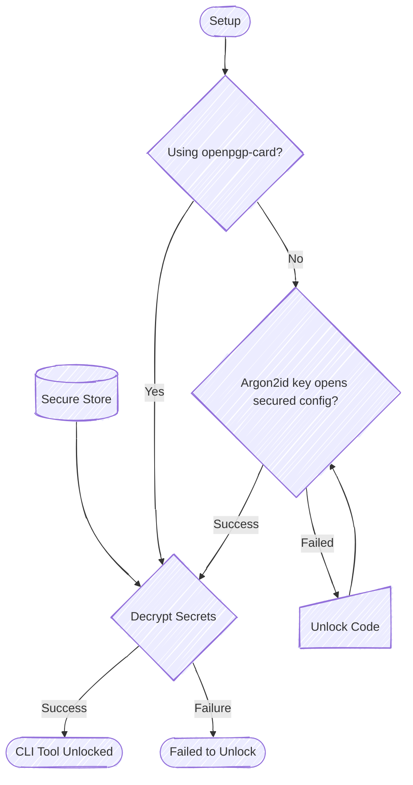
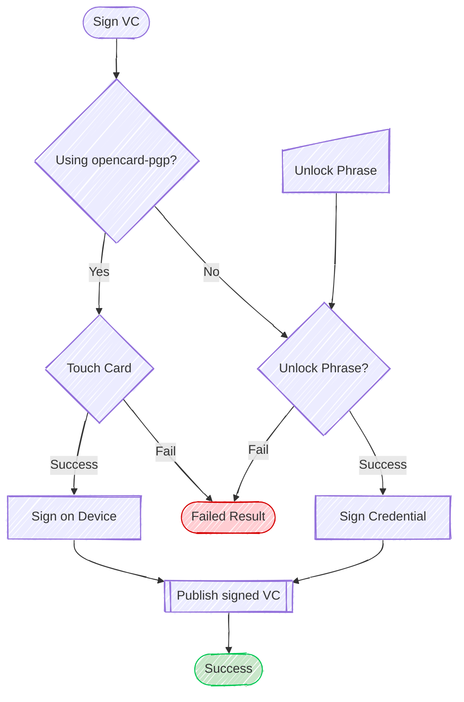

# OpenVTC Secure Key Management Design

The OpenVTC CLI tool requires the use of many secret keys for it to work; at a minimum
the following keys are required:

- **Persona DID**
  - `SIGNING_KEY`: Primary signing key used to sign Verified Credentials (VCs) and
    Verifiable Presentations (VPs).
  - `AUTHENTICATION_KEY`: Proof of ownership of the private key associated with
    this public key.
    - This key is used to identify this account. Can be used for SSH access,
      challenge/response services, etc.
  - `ENCRYPTION_KEY`: Used to encrypt/decrypt data.

- **DID Management (WebVH Management Keys)**
  - N x pre-rolled LogEntry update keys (where N = # of keys defined in WebVH Parameters)
  - Any other key material you wish to place into the DID Document
- **Relationship Credentials**
  - As you create relationships with other entities, a specific relationship DID
    is created for each relationship with its own separate set of keys

All of the above is linked back to the `Persona DID`.

## Key backends

Where these keys live depends on the profile's key backend (`KeyBackend` in
`openvtc-core/src/config/mod.rs`):

- **VTA (the normal case).** Keys are created and held by a VTA service.
  Setup creates this backend. OpenVTC keeps a VTA credential
  bundle in its secured config, which it uses to authenticate to the VTA, and
  stores only non-secret references to the keys (the VTA's key ID, purpose and
  creation time).
- **BIP32 (legacy).** Keys are derived locally from a BIP32 seed held in the
  secured config. Existing BIP32-based configs still load, but setup no longer
  creates them. The derivation paths below apply only to this backend.

See [Handling Secured Configuration](./secured-configuration-management.md)
for how the secured config is stored and protected.

## Hardware tokens

OpenVTC can use a physical hardware token, such as those made by Nitrokey or
Yubikey, to protect the secured config. A token is optional.

Tokens **MUST** support the openpgp-card protocol.

## Derivation Paths (legacy BIP32 backend)

A BIP32-based config records each key's derivation path in its `key_info`. The
original layout reserved these paths:

| Path          | Description                                    |
| ------------- | ---------------------------------------------- |
| `m/0'/0'/`    | Reserved for OpenVTC management keys           |
| `m/1'/0'/`    | Reserved for Persona DID Keys                  |
| `m/2'/1'/`    | Reserved for Persona DID WebVH Management keys |
| `m/3'/1'/1'/` | Reserved for Relationship DID keys             |

The current code still derives two of them for BIP32-based configs:
`m/0'/0'/0'` (the legacy key for the protected config, used only to read a
config written before the stored protected-config key existed) and
`m/3'/1'/1'/N` (relationship DID keys).

### Starting Key Space mapping

The original layout's starting key paths were:

- Persona DID Path `m/1'/0'/`
  - `m/1'/0'/0'` :: Persona DID Signing Key
  - `m/1'/0'/1'` :: Persona DID Authentication Key
  - `m/1'/0'/2'` :: Persona DID Encryption Key

- WebVH DID Management Path `m/2'/1'`
  - `m/2'/1'/<n>'` :: Pre-rolled update keys for WebVH LogEntries

## Initial setup

Setup connects to a VTA. The VTA mints the persona's keys and DID. You then
choose how the secured config is protected:

- a hardware token;
- an unlock code (recommended when no token is used); or
- no unlock code, which setup allows only after a warning.

## CLI Tool unlock

Whenever the CLI tool executes, it needs to unlock the secured config so it
can authenticate to the VTA and use DIDComm to interact with other services.

With an unlock code, the tool derives a key from the code with Argon2id and
tries to decrypt the stored secured config with AES-256-GCM. The unlock code
itself is never stored. A wrong code fails the AES-GCM authentication check,
and the prompt asks again. See
[Unlock Code](./secured-configuration-management.md#unlock-code) for the
parameters.

### Configuration management

There are three configuration stores for the OpenVTC CLI tool:

1. SecuredConfig :: OS credential store, or the encrypted file store
   (`OPENVTC_SECURE_STORE=file`, Linux). Holds the VTA credential bundle (or,
   for legacy configs, the BIP32 seed), key information, and the key that
   encrypts the ProtectedConfig.
2. ProtectedConfig :: Encrypted sensitive configuration (the account, its
   personas and communities, relationships, contacts, etc.)
   - Encrypted with AES-256-GCM under a random 32-byte key stored in the
     SecuredConfig. Older configs encrypted under a key derived from
     `m/0'/0'/0'` (BIP32) or from the VTA credential are still read, and are
     re-encrypted under the stored key on the next save.
3. PublicConfig :: Non-sensitive configuration, contains the encrypted ProtectedConfig

See [Config Data Structure](./openvtc-config-data-structure.md) for what each
store holds.

## Signing Verifiable Credential

Whenever the CLI tool needs to create and sign a verifiable credential, it must
use the `SIGNING_KEY`.

If you are using a hardware token, it is **_STRONGLY_** recommended to enable MFA
(e.g., touch activation) on the signing key.

## Relationship DID Key Management

When you create a relationship with another entity, a new DID may be created.

A relationship DID is a DID:PEER with two keys:

1. Verification Key (Ed25519)
2. Encryption Key (X25519)

With the VTA backend, the VTA creates these keys. With the legacy BIP32
backend, they are derived locally from the relationship key space:

- `m/3'/1'/1'/N` :: Relationship DID key space

This allows for some flexibility in the future if the derivation paths need to be
changed.
